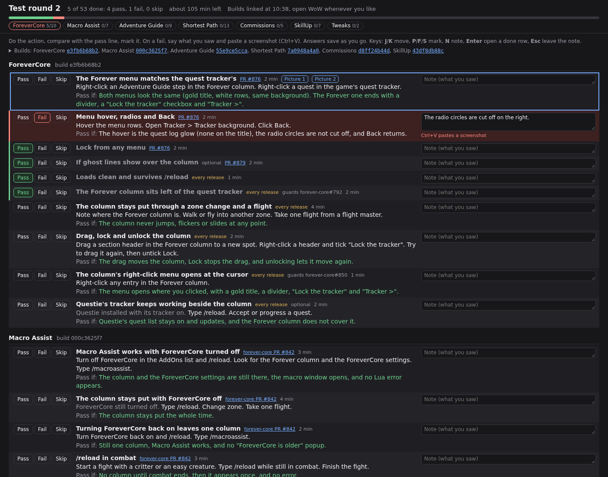

# Test checklist

The page the user works through in the live client before an addon release, and the results the coordinator reads.
It is coordinator tooling: nothing here is vendored into an addon or loaded by the game.



```sh
tools/checklist/checklist new 2026-11-19-3 --title "Test round 3"     # start a round
tools/checklist/checklist build --addon shortest-path-forever --sha <sha> --pr 1066 --build "PR head"
tools/checklist/checklist add --addon shortest-path-forever --pr 1066 \
  --title "No detours while planning to Darkshire" --setup "Stand in Stormwind." \
  --step "Set a journey to Darkshire in Duskwood." --step "Watch the tracker while it searches." \
  --pass "No route shown sends you somewhere and back." --picture <url at the PR head SHA> --minutes 2
tools/checklist/checklist serve                # 127.0.0.1:8765, saves each answer as it is given
tools/checklist/checklist open                 # the newest round in google-chrome-stable
tools/checklist/checklist status               # pass, fail, notes and screenshots per check
tools/checklist/checklist status --addon shortest-path-forever --sha <sha>   # exit 0 only when that build passed
tools/checklist/checklist regression shortest-path-forever --issue shortest-path-forever#978 --title ... --pass ...
```

`checklist` runs `checklist.py` in `tools/pyproject.toml`'s environment. `--round` picks a round; the newest is the
default.

The page follows the system theme (dark when there is none) and keeps each check to one row: Pass, Fail and Skip,
the title, the setup and steps run together as one action line, the pass line, and a note box. A passed or skipped row
folds to its title (click it or press Enter to open it); a failed row stays open. A sticky bar jumps to each addon with its answered count, the builds sit
behind one line, and expected pictures (`--picture`, repeatable) open on a click.

## Files

- `regression/<addon>.yaml`: the addon's standing checks, which join every round in which that addon has a build. They
  live here so a change to them is reviewed.
- `~/drive/proj/wow/wow-handoff/rounds/<date>-<n>.yaml`: one round: `builds` (addon, SHA, the PRs it carries, how it was
  built) and `checks` (addon, title, setup, steps, pass, picture, minutes, pr, optional).
- `~/drive/proj/wow/wow-handoff/results/<round>.json`: every answer with its note, the build SHA it was given against
  and the pasted screenshots under `results/<round>/`. Finishing the round adds `bugs`: the BugGrabber errors logged
  since the page was first opened (the client writes them on /reload or logout).

`CHECKLIST_HOME`, `CHECKLIST_PORT` and `CHECKLIST_BUGGRABBER` move the data folder, the port and the error log.

## Shepherd workflow

1. When a PR needs the user's eyes, add its checks to the coordinator's current round with `checklist add`: one check
   per thing to look at, steps a first-time reader can follow, a pass line that says exactly what they see, and the
   PR's screenshot at its head SHA (or a headless capture) as `--picture`.
2. The coordinator records each linked build with `checklist build`, runs `checklist serve` and opens the page.
3. Read `checklist status` for results; a fail carries the user's note and screenshot.
4. Record `--artifact` (the unpacked build linked into AddOns; its files are hashed), `--digest` (its runtime digest)
   and `--client-build` (the client's version line) with `checklist build` so a pass binds to the exact runtime;
   `status --json` returns them under `build`, with the artifact's hash now as `artifact_sha256_now`. A page left open
   from an earlier build cannot record a status for the new one.
5. `forever_client.py attest --repo X --ref S --checkout PATH` turns a passed build into its `.visual-proof.json`.
6. Release tooling gates on `checklist status --addon X --sha S`: exit 0 when every check for that exact build passed (a
   skip passes only on a check marked optional), 1 when one did not, 2 when no round covers the build.

## Rule: every bug the user finds becomes a regression check

When a bug the user found is fixed, the fix's PR adds a check to that addon's `regression/<addon>.yaml`
(`checklist regression <addon> --issue <repo>#<n> ...`) that would have caught it. It then joins every later round in
which the addon ships, so the same bug cannot come back unseen.
